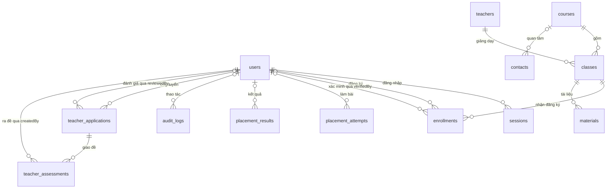

# Database SQL Server — Trung tâm ngoại ngữ

Bản SQL Server dựa trên 16 bảng thực tế của dự án Vinh Language Center, gồm hồ sơ CV và bài kiểm tra giáo viên. Bản cập nhật 31/10/2026 hỗ trợ **16 ngôn ngữ, 99 khóa học, 24 giáo viên, 302 lớp và 463 câu hỏi** (288 câu năng lực mới, 175 câu khảo sát cũ). Có đầy đủ script tạo bảng, khóa chính/ngoại, dữ liệu mẫu và truy vấn để thực hành trong SQL Server Management Studio (SSMS).

## Mở database đã tạo trên máy này

- Server name: **`localhost`** (kết nối kiểm tra trả về instance **`manh\MAYAO`**).
- Authentication: **Windows Authentication**.
- Trong Object Explorer: **Databases → Refresh → TrungTamNgoaiNgu → Tables**.
- Đã tạo và kiểm tra trên **SQL Server 2022, phiên bản 16.0.1210.3**, ngày 22/10/2026.
- Có thể mở `03-queries.sql` và nhấn **Execute / F5** để xem khóa học, giáo viên, lớp, học viên và điểm.

## Tạo trên một máy khác

Cần SQL Server 2016 trở lên và SSMS, quyền tạo database. Mở từng file trong SSMS và chạy theo thứ tự:

1. **`01-schema.sql`**: tạo database `TrungTamNgoaiNgu`, 16 bảng, các index và 3 view. File từ chối ghi đè nếu database đã có bảng.
2. **`02-sample-data.sql`**: thêm 99 khóa, 24 giáo viên, 302 lớp nhiều ca, 463 câu hỏi, 3 bài viết, 2 tài khoản, 1 đăng ký và 1 yêu cầu tư vấn mẫu. Chạy lại file này sẽ bỏ qua dữ liệu đã nhập, giữ chỉnh sửa hiện có.
3. **`03-queries.sql`**: 12 nhóm truy vấn minh họa, gồm lọc lớp theo ngôn ngữ/cấp độ, chỉ đọc dữ liệu.
4. **`04-verify.sql`** (tùy chọn): kiểm tra trên dữ liệu mẫu; các lệnh thử sửa/thêm được rollback.
5. **`05-verify-relationships.sql`** (tùy chọn): đối chiếu đủ 15 khóa ngoại, kiểu cột, cho phép NULL, hành vi xóa, bản ghi mồ côi và thử ghi/xóa sai liên kết. Tạo bản ghi thử riêng rồi rollback; không yêu cầu dữ liệu mẫu.

Lệnh PowerShell tương đương, chạy tại thư mục dự án:

```powershell
sqlcmd -S localhost -E -C -b -f 65001 -i database/sqlserver/01-schema.sql
sqlcmd -S localhost -E -C -b -f 65001 -i database/sqlserver/02-sample-data.sql
sqlcmd -S localhost -E -C -b -f 65001 -i database/sqlserver/03-queries.sql
```

`-C` ở đây dùng cho máy local với chứng chỉ tự ký. Khi dùng server từ xa cần cấu hình chứng chỉ tin cậy. Nếu tên instance khác, thay `localhost` bằng tên SQL Server của máy đó.

## Nâng cấp database đã có từ bản tiếng Anh

Sao lưu database, chạy **`06-multilingual-migration.sql`**, rồi **`07-multilingual-data.sql`**. Không chạy lại file `01` hoặc `02`. Hai file nâng cấp thêm cột còn thiếu và dữ liệu cho 15 ngôn ngữ mới, không dùng ID cố định và không ghi đè nội dung hiện có. Trên máy này đã sao lưu và nâng cấp database `TrungTamNgoaiNgu` thành công ngày 30/10/2026; 11 khóa ngoại vẫn hợp lệ.

Các bảng `courses`, `questions`, `placement_attempts`, `placement_results` có cột `language` (mã `en`, `zh`, `ko`, `ja`…). `teachers.languages` chứa mảng JSON các mã ngôn ngữ giáo viên dạy. Ngôn ngữ của lớp được xác định qua khóa học, không lưu lặp thêm một cột trong lớp. Danh mục 16 mã dùng chung với ứng dụng nằm tại `shared/languages.js`.

## Nâng cấp cấp độ và bài năng lực

Database đã có 16 ngôn ngữ: sao lưu rồi chạy **`08-competency-migration.sql`**, **`09-competency-data.sql`**. Đã nâng cấp database trên máy này ngày 31/10/2026 và kiểm tra lại đủ 11 khóa ngoại. Cột `courses.levelCode` dùng để xếp lớp; `questions.levelCode/skill/assessment` phân loại đề; `placement_results.analysis` lưu JSON kết quả từng nhóm/kỹ năng; `placement_attempts.assessment` ghi loại lượt thi.

View `vw_LichKhaiGiang` có thêm `NgonNgu`, `CapDo`. Xem [quy tắc xếp lớp và giới hạn bài kiểm tra](../../docs/COMPETENCY.md). Chấm bài và lọc lớp còn chỗ do backend thực hiện; script SQL không tự cấp chứng chỉ hoặc tự suy ra trình độ từ một tổng điểm.

## Nâng cấp tuyển dụng giáo viên

Sao lưu database đã có rồi chạy **`10-teacher-recruitment.sql`**. Bổ sung `teacher_applications` (CV nhị phân, chuyên môn khai báo, trạng thái, đánh giá) và `teacher_assessments` (đề theo ngôn ngữ/cấp độ được QTV xác nhận, bài làm, hạn nộp). Có bốn khóa ngoại mới, tổng cộng 15. Chạy lại không ghi đè hồ sơ. Sau đó chạy `05-verify-relationships.sql` để kiểm tra toàn bộ quan hệ.

Đề tuyển dụng được lưu riêng thành bản chụp; không nối khóa ngoại từ câu hỏi JSON đến ngân hàng câu hỏi có thể thay đổi. QTV phải đối chiếu CV, giao đề và chấm tự luận trước khi duyệt; backend kiểm tra quy trình này. Xem [luồng tuyển dụng và API](../../docs/teacher-recruitment.md).

## Các bảng và vai trò

| Bảng | Chức năng | Quan hệ chính |
| --- | --- | --- |
| `users` | Tài khoản Admin/học viên; thông tin cá nhân, mật khẩu băm | `role`: admin hoặc student |
| `courses` | Khóa học, học phí VND, trình độ, số tuần/buổi | Một khóa có nhiều lớp |
| `teachers` | Giáo viên, bằng cấp, thành tích, quốc tịch | Một giáo viên dạy nhiều lớp |
| `classes` | Lớp, thời gian, cơ sở, phòng, sĩ số | `courseId`, `teacherId` |
| `enrollments` | Đăng ký khách/học viên, trạng thái, điểm 4 kỹ năng | `classId`, `userId`, `verifiedBy` |
| `questions` | Câu hỏi trắc nghiệm, lựa chọn, đáp án | Đáp án chỉ số 0–3 |
| `placement_attempts` | Lượt làm bài, bộ câu hỏi cố định, hạn nộp | `userId` |
| `placement_results` | Kết quả kiểm tra và trình độ gợi ý | `userId` |
| `materials` | Tài liệu nhị phân, tên tệp, loại tệp, kích thước | `classId` |
| `news` | Bài viết và tin tức | Độc lập |
| `contacts` | Yêu cầu tư vấn/học thử, ghi chú xử lý | `courseId` |
| `sessions` | Mã phiên đã băm và hạn đăng nhập | `userId` |
| `audit_logs` | Nhật ký thao tác quản trị | `actorId` |
| `metadata` | Phiên bản dữ liệu/đánh dấu nhập mẫu | Khóa `key` |
| `teacher_applications` | CV riêng tư, ngôn ngữ/cấp độ, kinh nghiệm, quyết định tuyển dụng | `userId`, `reviewedBy` |
| `teacher_assessments` | Các lần giao đề, trắc nghiệm, tự luận, lưu nháp và hạn nộp | `applicationId`, `createdBy` |

Học viên nằm trong `users` với `role='student'`; không tạo thêm bảng học viên trùng thông tin. Đăng ký khách có `userId=NULL` đến khi được tiếp nhận. Lịch học và cơ sở nằm trong `classes`, theo thiết kế hiện tại của website.



Hai liên kết từ `users` đến `enrollments` có vai trò khác nhau: `userId` là học viên, `verifiedBy` là người xác minh. Các bảng câu hỏi, tin tức và metadata độc lập nên không nằm trong sơ đồ quan hệ trên. Bộ câu hỏi của lượt làm bài và phần xem lại kết quả được lưu JSON như một bản chụp; không có khóa ngoại từ JSON đến bảng câu hỏi đang được chỉnh sửa.

## Kiểu dữ liệu và ràng buộc

- Nội dung tiếng Việt dùng `NVARCHAR` và literal `N'...'`.
- ID tự tăng dùng `IDENTITY`; ngày dùng `DATE`, giờ dùng `TIME(0)`, thời điểm dùng `DATETIME2(0)` UTC. Ngày sinh/giờ trống chuyển thành `NULL`.
- Học phí dùng `DECIMAL(12,0)` VND; tệp dùng `VARBINARY(MAX)`, tối đa 5 MB, kích thước phải khớp dữ liệu.
- Các trường `weekdays`, `grades`, `options`, `review`, bộ đề trong lượt thi giữ dạng JSON để dễ đối chiếu code hiện tại. `ISJSON` kiểm tra cú pháp JSON. [Tài liệu Microsoft về JSON](https://www.microsoft.com/en-us/sql-server/blog/?p=14671).
- Email tài khoản duy nhất, không phân biệt chữ hoa/thường. Hai unique filtered index ngăn đăng ký còn hiệu lực bị trùng email/lớp hoặc tài khoản/lớp; bản đã hủy không cản đăng ký mới. [Filtered indexes — Microsoft Learn](https://learn.microsoft.com/en-us/sql/relational-databases/indexes/create-filtered-indexes).
- Có kiểm tra trạng thái, vai trò, học phí, sĩ số, khoảng ngày/giờ và điểm bài test không vượt tổng câu. Không tự xóa lớp/đăng ký khi xóa khóa học hoặc giáo viên còn liên kết.
- Các kiểm tra phức tạp hiện thuộc backend: trùng lịch giáo viên/phòng, duyệt không vượt sĩ số, ngày sinh không ở tương lai, giá trị từng điểm kỹ năng 0–10, cấu trúc 4 lựa chọn và ngày học 1–7. Script này không triển khai lại các nghiệp vụ đó bằng trigger; khi viết ứng dụng SQL Server cần giữ validation và transaction tương ứng.
- Khóa ngoại đến `users` kiểm tra tài khoản tồn tại, không kiểm tra `role`. Backend phải bảo đảm `enrollments.userId` thuộc học viên và `enrollments.verifiedBy` thuộc Admin; kiểm soát quyền ghi nhật ký cũng nằm ở backend.
- `audit_logs.recordId` đi kèm `resource` để ghi nhiều loại đối tượng nên không có khóa ngoại đến một bảng cố định. Nhật ký vẫn giữ được sau khi đối tượng nghiệp vụ bị xóa.

## Dữ liệu mẫu và kết nối website

Tất cả dữ liệu được tạo từ seed mới trong bộ nhớ, không sao chép học viên, mật khẩu, phiên đăng nhập hoặc chuỗi kết nối của website online. Thành tích giáo viên là nội dung minh họa đồ án.

Tài khoản mẫu trong bản SQL Server: `admin@vinhenglish.vn` / `Admin@123456` và `hocvien@example.com` / `Student@123456`. Bảng lưu hash scrypt gồm salt và hash; đây là tài khoản ứng dụng, không phải SQL Server Login. Chỉ dùng để học tập, không dùng lại mật khẩu mẫu khi công khai ứng dụng.

**Website hiện tại vẫn dùng SQLite/PostgreSQL. Bộ file này chưa chuyển backend sang SQL Server.** Không thể chỉ đổi `DATABASE_URL` thành chuỗi SQL Server: cần thêm driver `mssql`, chuyển cú pháp truy vấn/transaction/identity, ánh xạ `DATE`/`TIME`/`NULL` và kiểm tra lại các API. React có thể giữ nguyên vì gọi qua API.

## Kiểm tra thực tế

- Tạo schema và nhập mẫu trên SQL Server 2022 thành công.
- 16 bảng, 3 view; số bản ghi khóa/giáo viên/lớp/câu hỏi sau nâng cấp là 99/24/302/463, gồm 16 ngôn ngữ. Trong đó có 288 câu năng lực, mỗi nhóm đủ từ vựng/ngữ pháp/đọc hiểu. Hai bảng tuyển dụng khởi tạo trống, không tạo CV giả.
- File kiểm tra có 12 tình huống dữ liệu sai phải bị từ chối và 1 tình huống cho phép đăng ký lại sau khi hủy; mọi thay đổi thử rollback.
- Chạy lại file dữ liệu mẫu không thêm bản ghi trùng. Chạy lại file schema từ chối ghi đè.
- Đối chiếu 15 khóa ngoại đang bật và được SQL Server tin cậy; không có bản ghi mồ côi. Thử ID sai ở đủ 15 liên kết, 6 trường hợp xóa bị chặn và 4 hành vi CASCADE/SET NULL: đạt. Xem [báo cáo quan hệ](RELATIONSHIP-REVIEW.md).

Giữ những file này để nộp đồ án hoặc tạo lại database; không cần `.bak` để chạy script.
